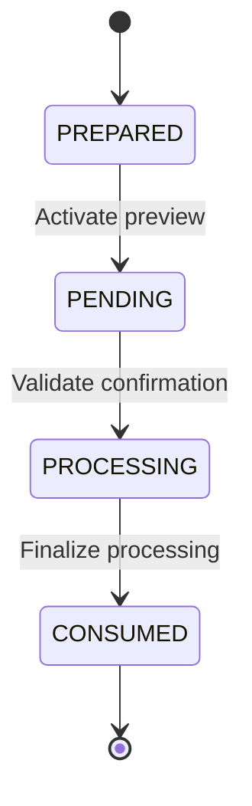
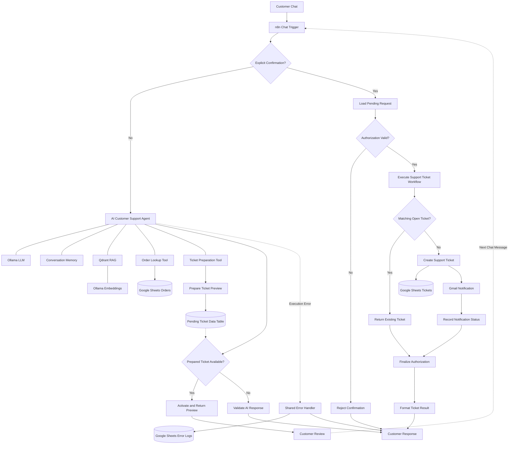

# Northstar Customer Support Agent

**AI-Powered Customer Support Automation | n8n + Ollama + Qdrant**

## Project Overview

Northstar Customer Support Agent is a locally hosted AI-powered customer support automation solution built for a fictional UK-based outdoor equipment retailer.

The project demonstrates how businesses can combine AI agents, retrieval-augmented generation (RAG), structured business data, and deterministic workflow automation to handle common customer service requests.

Rather than relying entirely on an LLM to execute business operations, the solution separates AI-driven reasoning from controlled business execution.

This architecture is designed to reduce repetitive manual work, improve operational consistency, and mitigate risks associated with AI-generated decisions.

**Project Status:** v1.1 — Functional development demo using synthetic customer and order data.

## Business Challenges

Customer support teams frequently spend time handling repetitive operational tasks:

- Answering questions about shipping, returns, refunds, and store policies.
- Checking order status and delivery information.
- Identifying delayed deliveries and customer complaints.
- Collecting information for human support escalation.
- Creating and tracking support tickets.
- Preventing duplicate support requests.
- Handling automation failures without exposing technical information to customers.

## Solution

The solution combines the following capabilities:

- AI-powered customer interaction and contextual reasoning.
- RAG-based policy retrieval.
- Structured order data integration.
- Deterministic delivery status calculation.
- Human-in-the-loop support ticket approval.
- Persistent authorization state management.
- Replay protection and business-level duplicate detection.
- Centralized error handling and notification tracking.

The core design principle is:

> AI interprets customer intent and prepares business requests. Deterministic workflows validate authorization and execute business operations.

## Technology Stack

| Technology | Purpose |
|---|---|
| n8n | Workflow orchestration and business automation |
| Ollama | Locally hosted LLM inference |
| Qwen3:14b | Customer interaction and contextual reasoning |
| nomic-embed-text | Text embeddings |
| Qdrant | Vector storage and semantic knowledge retrieval |
| Google Sheets | Order records, support tickets, and error logs |
| n8n Data Tables | Pending requests and authorization state management |
| Gmail | Support team notifications |
| Docker | Local service deployment |
| JavaScript | Validation, deterministic business logic, and response formatting |
| GitHub | Version control and portfolio documentation |

## Key Features

### 1. AI-Powered Customer Support

- Uses a locally hosted Ollama language model (`qwen3:14b`) to interpret customer requests.
- Maintains conversational context through shared conversation memory.
- Identifies customer intent and selects appropriate tools.
- Supports multi-turn customer service conversations.
- Uses structured instructions to limit unsupported claims and unauthorized actions.

### 2. Context-Aware RAG

- Integrates Qdrant as a vector database for store policy retrieval.
- Uses Ollama embeddings (`nomic-embed-text`) for semantic search.
- Rewrites context-dependent customer questions into standalone retrieval queries.
- Retrieves relevant knowledge about shipping, returns, refunds, warranties, compensation, and support escalation.
- Instructs the AI Agent to acknowledge insufficient policy information rather than inventing policies.

### 3. Verified Order Lookup

- Retrieves synthetic order records from Google Sheets.
- Requires both an order ID and customer email.
- Validates supplied information against matching order records.
- Withholds order information when the supplied details do not match.
- Returns structured order status, tracking number, carrier, and estimated delivery information.

**Security note:** Matching an order ID and customer email is a demo-level access check, not production-grade customer authentication.

### 4. Deterministic Delivery Status Calculation

Delivery status and overdue days are calculated using JavaScript rather than relying on the language model.

The workflow:

- Validates estimated delivery dates.
- Uses the Europe/London time zone for date-based calculations.
- Calculates calendar days overdue.
- Distinguishes delivered, cancelled, pending, in-transit, and overdue orders.
- Returns structured results to the AI Agent.

This approach reduces the risk of incorrect date calculations and unsupported delivery status assumptions.

The system does not provide live carrier tracking.

### 5. Human-in-the-Loop Support Escalation

The support escalation process separates ticket preparation from ticket creation.

1. The AI Agent identifies a request requiring human assistance.
2. The Agent collects the required customer and issue information.
3. A deterministic workflow generates a structured ticket preview.
4. The pending request is stored in an n8n Data Table.
5. The customer reviews the proposed ticket.
6. The customer explicitly confirms the request.
7. A separate deterministic execution path validates the authorization.
8. The system creates a support ticket or returns an existing matching ticket.

The required confirmation phrase is:

`CONFIRM SUPPORT TICKET`

General conversational approval, such as "Yes", can initiate ticket preparation but cannot authorize formal ticket creation.

### 6. Persistent Authorization State Management

Pending support requests are stored in an n8n Data Table rather than relying exclusively on conversational memory.

Each request is associated with:

- A conversation session identifier.
- A request version identifier.
- Customer and order information.
- Issue classification and summary.
- A structured ticket preview.
- Authorization status.
- An expiration timestamp.

Pending requests have a 30-minute validity period.

The authorization lifecycle is:

Expired requests are rejected during authorization validation.

### 7. Replay Protection

The workflow validates the pending request before executing ticket creation.

Validation includes:

- Session matching.
- Request version matching.
- Authorization status.
- Request expiration.
- Ticket payload consistency.

Once an authorization has been processed, it cannot be reused through the normal confirmation path.

Repeated confirmation requests are rejected without intentionally creating additional tickets.

### 8. Business-Level Duplicate Detection

Duplicate detection operates independently of the conversation session.

The workflow checks existing open support tickets using business-level information, including:

- Customer email.
- Order ID.
- Issue classification.
- Ticket status.

When an existing matching open ticket is found, the system returns the existing ticket identifier instead of creating another ticket.

This mechanism was exercised in sequential cross-session testing.

### 9. Support Notification and Status Tracking

After a new support ticket is recorded:

- Gmail sends a notification to the support team.
- The notification outcome is recorded in Google Sheets.
- Successful and failed notifications are handled through separate workflow branches.
- The customer receives a structured response containing the ticket identifier and notification status.

A notification failure does not automatically mean that ticket creation has failed.

### 10. Centralized Error Handling

- Uses a reusable error-handling workflow.
- Classifies execution errors.
- Records technical error information in Google Sheets.
- Returns customer-friendly error messages.
- Handles empty AI Agent responses through a fallback mechanism.
- Supports configured retries for selected workflow failures.

## System Architecture

The solution uses a hybrid architecture consisting of an AI reasoning layer, a human authorization layer, and a deterministic business execution layer.

### Architectural Design Principles

| Design Principle | Implementation |
|---|---|
| Separation of concerns | AI reasoning and business execution use separate paths |
| Human-in-the-loop | Explicit confirmation is required before ticket creation |
| Deterministic execution | JavaScript and workflow conditions enforce business rules |
| Persistent state | Pending requests are stored outside conversational memory |
| Replay protection | Previously processed authorizations are rejected |
| Business-level deduplication | Matching open tickets are detected across sessions |
| Modular design | Reusable workflows separate business responsibilities |
| Error isolation | Technical errors are separated from customer-facing responses |

## Workflow Components

The project consists of five workflows.

| Workflow | Responsibility |
|---|---|
| [Northstar Customer Support Agent](workflow/p02-northstar-customer-support-agent-local.json) | Customer interaction, AI reasoning, RAG, tool orchestration, confirmation routing, and response formatting |
| [Order Lookup](workflow/p02-order-lookup.json) | Order retrieval, customer information matching, and deterministic delivery status calculation |
| [Create Support Ticket](workflow/p02-create-support-ticket.json) | Ticket preparation, authorization validation, duplicate detection, ticket creation, notification, and finalization |
| [Shared Error Handler](workflow/p02-shared-error-handler.json) | Error classification, technical logging, and customer-friendly error responses |
| [Knowledge Base Ingestion](workflow/p02-knowledge-base-Ingestion.json) | Knowledge document preparation, text splitting, embedding generation, and Qdrant ingestion |

### Main Workflow

The main workflow is organized into five functional areas:

1. Customer Entry & Routing
2. Authorized Ticket Execution
3. AI Agent & Knowledge Tools
4. Human-in-the-Loop
5. Response & Error Handling

### Support Ticket Workflow

The support ticket workflow is organized into five functional areas:

1. Request Validation & Routing
2. Ticket Preparation
3. Authorization & Replay Protection
4. Deduplication & Ticket Creation
5. Notification & Finalization

## Data Model

### Google Sheets — Orders

| Field | Description |
|---|---|
| order_id | Unique order identifier |
| customer_email | Customer email address |
| customer_name | Customer name |
| order_date | Order placement date |
| status | Recorded order status |
| tracking_number | Shipment tracking reference |
| carrier | Delivery carrier |
| estimated_delivery | Estimated delivery date |

### Google Sheets — Support Tickets

| Field | Description |
|---|---|
| ticket_id | Generated support ticket identifier |
| created_at | Ticket creation timestamp |
| session_id | Originating conversation session |
| customer_email | Customer email address |
| order_id | Associated order identifier |
| issue_type | Issue classification |
| issue_summary | Customer issue summary |
| ticket_status | Support ticket status |
| notification_status | Notification delivery status |

### n8n Data Table — Pending Support Tickets

Create a Data Table named `P02 - Pending Support Tickets`.

| Field | Data Type |
|---|---|
| session_id | String |
| request_id | String |
| customer_email | String |
| order_id | String |
| issue_type | String |
| issue_summary | String |
| preview_markdown | String |
| status | String |
| expires_at | Date |

The Data Table is used to persist pending requests and authorization state.

The workflow uses the automatically generated row identifier for record-level validation and updates.

## Setup and Configuration

### Prerequisites

- Docker or Docker Desktop.
- A self-hosted n8n version supporting AI Agent nodes and Data Tables.
- Ollama.
- Qwen3:14b language model.
- nomic-embed-text embedding model.
- Qdrant vector database.
- Google Sheets credentials.
- Gmail credentials.
- Network connectivity between n8n, Ollama, and Qdrant.

### Installation Overview

1. Deploy n8n, Ollama, and Qdrant.
2. Download the five workflow JSON files from the `workflow/` directory.
3. Import the supporting workflows into n8n.
4. Import the main Customer Support Agent workflow.
5. Configure Ollama and Qdrant credentials and service endpoints.
6. Create the Google Sheets resources for orders, support tickets, and error logs.
7. Configure Google Sheets nodes and field mappings.
8. Create the Pending Support Tickets Data Table using the schema above.
9. Bind all Data Table nodes to the newly created table.
10. Reconfigure the sub-workflow references in the main workflow.
11. Configure Gmail credentials and the support notification recipient.
12. Run the Knowledge Base Ingestion workflow to populate Qdrant.
13. Verify all workflow dependencies and publish the required workflows.
14. Perform functional testing before enabling customer access.

### Configuration Placeholders

The public workflow files have been sanitized to remove personal credentials and development-specific resource identifiers.

Examples of configuration placeholders include:

- `REPLACE_WITH_SPREADSHEET_ID`
- `REPLACE_WITH_PENDING_TICKETS_TABLE_ID`
- `REPLACE_WITH_ORDER_LOOKUP_WORKFLOW_ID`
- `REPLACE_WITH_CREATE_TICKET_WORKFLOW_ID`
- `REPLACE_WITH_ERROR_HANDLER_WORKFLOW_ID`

The support notification recipient is replaced with a demonstration email address.

Replace all placeholders and rebind the required credentials and resources before running the workflows.

**Important:** These files are configurable workflow templates, not a zero-configuration deployment package. The sanitized exports have undergone static validation but have not been independently redeployed and tested in a fresh n8n environment.

## Testing and Validation

### v1.1 Functional Regression Testing

| Test ID | Scenario | Observed Result |
|---|---|---|
| TC01 | Verified order lookup | Correct order details and overdue days returned |
| TC02 | Context-aware policy retrieval | Relevant escalation response returned; policy wording requires refinement |
| TC03 | Ticket preview | Structured preview generated before formal ticket creation |
| TC04 | Explicit confirmation | Support ticket created and notification received |
| TC05 | Repeated confirmation | Previously processed request rejected |
| TC06 | Confirmation without pending request | Unauthorized confirmation rejected |
| TC07 | Cross-session duplicate request | Existing matching open ticket identified |

All seven scenarios were exercised during development.

The core customer support journey, including ticket preparation, explicit confirmation, ticket creation, and notification delivery, was demonstrated successfully.

### Additional Development Testing

Earlier development testing also exercised:

- Order lookup with unmatched customer details.
- Qdrant knowledge retrieval.
- AI Agent execution failures.
- Shared error handling.
- Empty AI response fallback.

These results represent functional development testing rather than formal production acceptance testing.

Some negative-path scenarios were verified through returned responses; comprehensive downstream state reconciliation and automated regression testing remain future work.

## Business Value

The solution demonstrates how AI-powered automation can support customer service operations by:

- Reducing repetitive policy and order-related inquiries.
- Improving consistency in delivery status calculations.
- Structuring customer issues before human escalation.
- Reducing unnecessary duplicate support tickets.
- Maintaining customer control over business actions.
- Improving operational traceability through structured records.
- Supporting local LLM inference without requiring a commercial cloud LLM API.

These are intended business benefits. Quantitative cost savings, response time improvements, and production performance have not yet been measured.

## Known Limitations

### 1. Demo-Level Customer Verification

Order ID and email matching does not constitute production-grade customer authentication.

A production implementation would require stronger identity verification, access controls, and appropriate data protection measures.

### 2. Sequential Execution Scope

The authorization and duplicate detection mechanisms were designed and tested for sequential demonstration scenarios.

Concurrent ticket creation, transactional consistency, and distributed execution have not been validated.

The project does not claim production-grade exactly-once execution.

### 3. LLM Response Reliability

The locally hosted model may occasionally return empty responses or make unsupported policy interpretations.

Fallback responses and structured instructions mitigate these issues but do not eliminate all model-related risks.

### 4. Rule-Based Duplicate Detection

Duplicate detection relies primarily on structured business fields and issue classification.

It does not provide comprehensive semantic duplicate detection or guarantee that all distinct customer issues will be classified correctly.

### 5. External Service Dependencies

Although LLM inference and vector retrieval are locally hosted, the solution uses Google Sheets and Gmail.

The overall solution is therefore not fully offline or completely isolated from external services.

### 6. Synthetic Business Data

The project uses fictional customer, order, and support ticket records.

It has not been validated against a live retailer's production systems.

### 7. Environment-Specific Configuration

Credentials, resource identifiers, workflow references, and service endpoints must be configured for the target environment.

The public workflow templates require additional setup and deployment testing.

### 8. Operational Recovery

Comprehensive recovery from partial execution failures, authorization finalization failures, and interrupted processing has not been fully validated.

## Future Improvements

Potential enhancements include:

- Production-grade customer authentication and authorization.
- Automated functional and regression testing.
- Transactional ticket creation and stronger idempotency guarantees.
- Improved recovery from partial workflow failures.
- Enhanced policy retrieval and response evaluation.
- Monitoring of model performance and tool execution.
- Integration with enterprise CRM and ticketing platforms.
- Production deployment and operational documentation.

## Version History

| Version | Description |
|---|---|
| v1.0 | Initial AI customer support agent with RAG, order lookup, support escalation, and centralized error handling |
| v1.1 | Context-aware retrieval, deterministic delivery calculations, structured ticket previews, persistent authorization state, replay protection, and cross-session duplicate detection |

## Project Disclaimer

Northstar Outdoor Store is a fictional retailer created for demonstration purposes.

This project is an independent technical portfolio demonstration and is not affiliated with a real retail business.

**Version:** 1.1  
**Status:** Functional Development Demo  
**Architecture:** Hybrid AI Reasoning and Deterministic Workflow Execution  
**Primary Technologies:** n8n, Ollama, Qdrant, JavaScript, Docker, Google Sheets, Gmail
